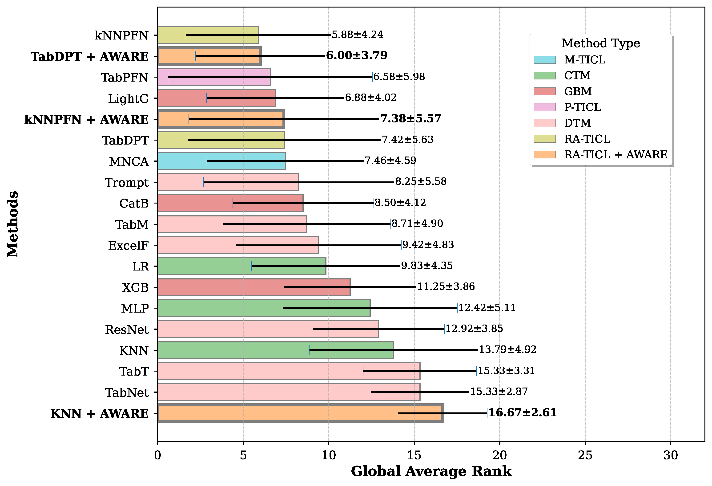
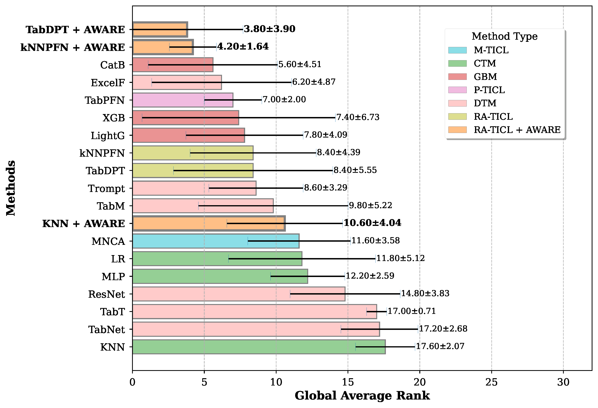
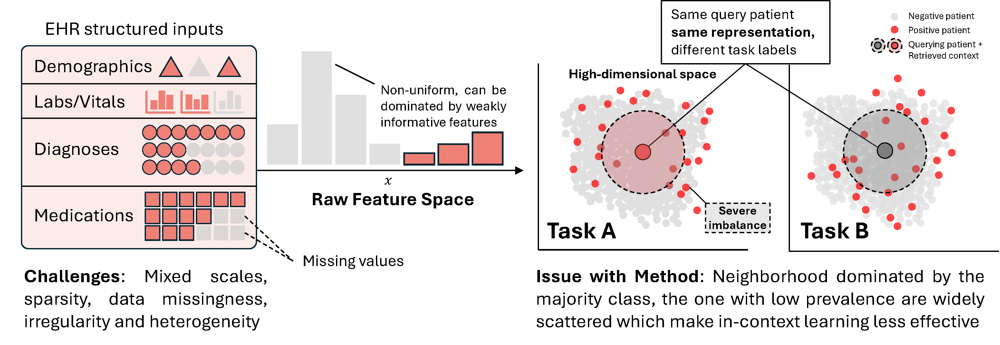
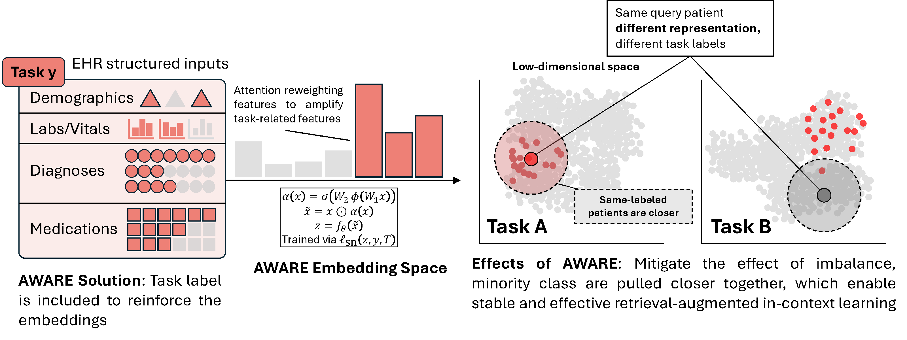

# Retrieval-aligned Tabular Foundation Models Enable Robust Clinical Risk Prediction in Electronic Health Records Under Real-world Constraints


| Small-medium sized datasets | Large-scale datasets |
| :---: | :---: |
|  |  |

> EHRPFN Inference is a specialized benchmarking framework for Electronic Health Record (EHR) data. It enables large-scale evaluation of various machine learning models—ranging from classical tabular models to state-of-the-art foundation models like **TabPFN** and **EHRPFN**. The project is built for extensibility, reproducibility, and rigorous performance assessment across multiple healthcare datasets.


---

## 🚀 Key Features

- **Multi-Model Support**: Evaluate classical ML (XGBoost, CatBoost), modern deep learning (via TALENT), and tabular foundation models.
- **EHR Foundation Models**: Native support for **EHRPFN** (TabDPT) and its variants (AWARE, KNNPFN).
- **Flexible Data Loading**: Seamlessly integrates with the `ehrmeds` library for loading MIMIC-IV, eICU, and other EHR datasets.
- **Experimental Pipelines**: Pre-configured scripts for scaling experiments (datasize, featuresize, imbalance, retrieval).
- **Reproducible Results**: Built using `hydra` for configuration and `uv` for dependency management.
- **Advanced Retrieval**: Built-in support for context-aware inference using EHR retrievers.


| Traditional Feature Space | 
| :---: | 
|  |

| Our Proposed Embedding Space (AWARE) |
| :---: | 
|  |


---

## 🛠️ Installation & Setup

This project uses `uv` for Python package management. To get started:

1.  **Clone the repository**:
    ```bash
    git clone https://github.com/kaylode/ehrpfn.git
    cd ehrpfn
    ```

2.  **Install dependencies**:
    ```bash
    uv sync
    ```

3.  **Configure Environment**:
    Create a `.env` file in the root directory (refer to `.env.example` if available) with the following variables:
    ```bash
    HYDRA_FULL_ERROR=1
    LOGGING_DIR="results/logs"
    TALENT_DIR="results/talent"
    SAVE_DIR="results"
    ```

---

## 📁 Project Structure

- `ehrpfn/`: Core package containing model wrappers, inference logic, and metrics.
    - `models/`: Implementations for EHRPFN, TabPFN, TabICL, and wrappers for TALENT models.
    - `data.py`: Data loading and preprocessing logic (integrated with `ehrmeds`).
    - `metrics.py`: Classification and regression evaluation metrics.
    - `inference.py`: Main entry point for running model evaluation.
- `scripts/`: Shell scripts for running various benchmark experiments.
- `configs/`: Hydra configuration files (`defaults.yaml`).
- `results/`: Output directory where scores and logs are saved.

---

## 🏗️ Models & Metrics

### Supported Models

| Category | Models |
| :--- | :--- |
| **Classical ML** | `xgboost`, `rf`, `catboost`, `lightgbm`, `mlp`, `logistics`, `knn-simple` |
| **Foundation Models** | `tabpfn`, `ehrpfn` (TabDPT), `tabicl` |
| **EHR-Specific** | `knnpfn`, `tabdpt_aware`, `knnpfn_aware` |
| **Deep Learning** | `danets`, `beta`, `resnet`, `tabr`, `modernNCA`, `tabm`, `tabtransformer`, `tabnet`, `excelformer`, `trompt` |

### Evaluation Metrics

- **Binary Classification**: AUROC, AUPRC, Balanced Accuracy, F1-score, Precision, Recall, MCC, Sensitivity, Specificity.
- **Regression**: MSE, MAE, R2, RMSE, EVS, MedAE, MSLE.

---

## 📊 Datasets

The project leverages `ehrmeds` for consistent and reproducible dataset loading. Supported datasets include:

- **MIMIC-IV**: Clinical data from the Beth Israel Deaconess Medical Center.
- **eICU**: Data from the eICU Collaborative Research Database.
- **OpenML EHR**: Healthcare-specific datasets from OpenML.
- **Synthea**: Synthetic health records.
- **SJH CPE**: Dataset for Chronic Pulmonary Exacerbation (St. Joseph Hospital).

---

## 🏃 Running Experiments

The project provides high-level shell scripts in the `scripts/` directory to run various benchmarks and experiments.

### Basic Inference Example

To run simple inference for a specific model on a dataset (e.g., CatBoost on MIMIC-IV):

```bash
bash scripts/inference.sh catboost mimiciv null null 100
```

---

## 🔄 Reproduction Guide

For full reproduction of the results:

1.  **Set up the environment** and `.env` file as described in the Installation section.
2.  **Execute the benchmark scripts** for all combinations of models and datasets.
3.  **Extract Scores**: After execution, the results will be saved in `${SAVE_DIR}/benchmark/${SEED}/${DATASET}/${TASK}/${MODEL}/score.json`.
4.  **Aggregate Results**: Use a tool like `pandas` to aggregate results for final comparison.

---

## 🛠️ Configuration (Hydra)

The project uses `hydra` to manage configurations. You can override any parameter directly from the command line:

```bash
uv run ehrpfn/inference.py \
    data.data_name=mimiciv \
    inference.model=xgboost \
    inference.seed=42 \
    wandb.use_wandb=true
```

Refer to `configs/defaults.yaml` for a complete list of configurable parameters.

## Citation
```
@article{pham2026retrieval,
  title={Retrieval-aligned Tabular Foundation Models Enable Robust Clinical Risk Prediction in Electronic Health Records Under Real-world Constraints},
  author={Pham, Minh-Khoi and Ho, Thang-Long Nguyen and Dao, Thao Thi Phuong and Mai, Tai Tan and Tran, Minh-Triet and Ward, Marie E and Geary, Una and Brennan, Rob and McDonald, Nick and Crane, Martin and others},
  journal={arXiv preprint arXiv:2604.01841},
  year={2026}
}
```